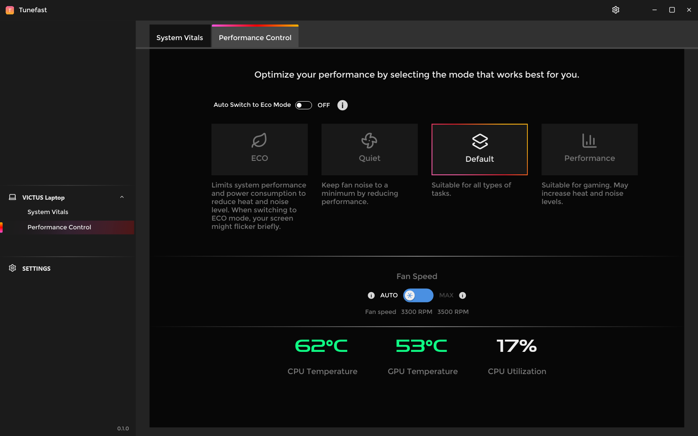

<p align="center">
  
</p>

<h1 align="center">Tunefast</h1>

<p align="center"><strong>OMEN Gaming Hub, native and fast.</strong><br>ONE_LINE_PITCH</p>

<p align="center">
  <a href="https://github.com/Readtt/tunefast/releases/latest"><strong>Download</strong></a> ·
  <a href="#build-from-source">Build from source</a> ·
  <a href="#how-it-works">How it works</a>
</p>

<p align="center">
  
  
  
</p>

Tunefast is a from-scratch native rebuild of OMEN Gaming Hub in Rust with
[iced](https://iced.rs), drawn on the CPU. It keeps
the interface you know and the features you use every day, without a
browser engine: HEADLINE_NUMBERS_SENTENCE.



## The numbers

<!-- bench:start -->
BENCH_TABLE
<!-- bench:end -->

## How it feels

<!-- feel:start -->
FEEL_TABLE
<!-- feel:end -->

## What it does

| Feature | Status |
|---|---|
FEATURE_ROWS

## Install

Download the build for your platform from the
[latest release](https://github.com/Readtt/tunefast/releases/latest), unzip it
and run `tunefast`. Windows builds are portable single executables.

To look around without an account, start it with sample data:

```sh
tunefast --demo
```

## Build from source

You need [Rust](https://rustup.rs) (the pinned version installs itself) and,
on Linux, `libxkbcommon-dev libwayland-dev libgl1-mesa-dev`.

```sh
git clone https://github.com/Readtt/tunefast
cd tunefast
cargo run --release            # the real thing
cargo run --release -- --demo  # sample data, no account
```

## How it works

HOW_IT_WORKS

The behaviour of the original was studied with
[REA](https://github.com/morluto/rea) (static analysis of the shipped app and
its network traffic). No original source code, artwork or fonts are included.

## Not affiliated

Tunefast is an independent project. It is not affiliated with, endorsed by, or
connected to HP Inc.. OMEN Gaming Hub is a trademark of HP Inc..

## Acknowledgements

[iced](https://github.com/iced-rs/iced),
the [Inter](https://rsms.me/inter/) typeface (OFL), [Lucide](https://lucide.dev)
icons (ISC) and [REA](https://github.com/morluto/rea).

## License

[MIT](LICENSE)
